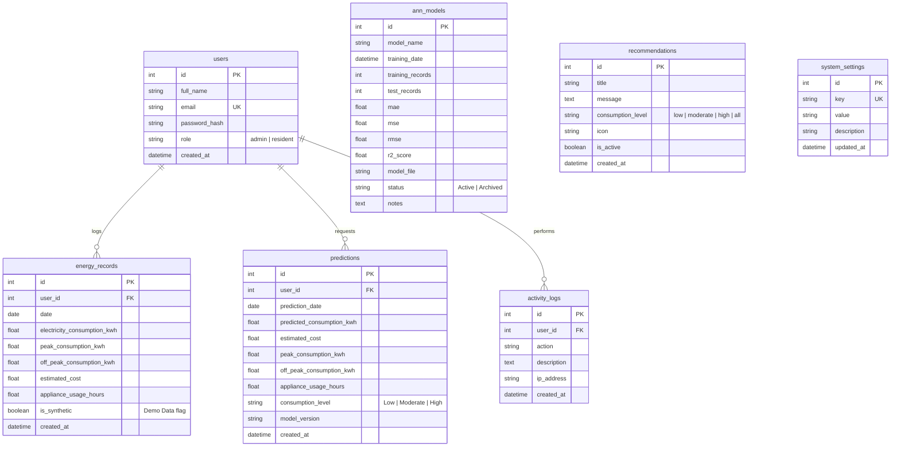

# Smart Energy Management System Using Artificial Neural Network (ANN)

> **Project Title:** Design and Implementation of a Smart Energy Management System Using Artificial Neural Network (ANN) for Residential Buildings  
> **Target Standard:** National Diploma (ND) Computer Science Final-Year Project  
> **Architecture:** 100% Software-Only Web Application (No IoT, microcontrollers, Arduino, ESP32, or physical smart meters required)

---

## 1. Executive Summary & Project Overview

The **Smart Energy Management System** is a software-based web application designed to help residential households monitor, analyze, and forecast electricity consumption using an **Artificial Neural Network (ANN)**.

Traditional smart energy solutions often require expensive IoT hardware, microcontroller interfaces (Arduino/ESP32), or specialized sensor arrays. This system eliminates hardware barriers by operating purely on **historical and manually entered residential energy-consumption data** stored in a PostgreSQL database.

The core intelligence is powered by a **Multi-Layer Perceptron (MLPRegressor)** neural network implemented with Scikit-learn. The ANN model learns non-linear consumption patterns across calendar dynamics, seasonal factors, appliance usage hours, and peak/off-peak load splits to deliver accurate next-day and monthly demand forecasts with cost estimation in **Nigerian Naira (₦)**.

---

## 2. Key Features

### For Residents & Households
* **Household Energy Dashboard:** Live KPI metrics displaying Total Consumption (kWh), Daily Average (kWh/day), ANN Predicted Demand (kWh), and Estimated Monthly Cost (₦).
* **Manual Data Entry:** Fast logging of daily total electricity (kWh), peak load, off-peak load, and appliance operating hours with validation.
* **ANN Energy Demand Forecast:** Interactive prediction form simulating expected appliance hours and peak distribution to forecast future consumption and billing.
* **Consumption Tier Classification:** Instant classification into **Low** (Green), **Moderate** (Amber), or **High** (Red) based on configurable system thresholds.
* **Dynamic Smart Recommendations:** Context-aware energy conservation tips tailored to the household's current consumption tier.
* **Visual Analytics:** Interactive Chart.js graphs for 14-day consumption trends, peak vs off-peak stacked breakdowns, and ANN Predicted vs Actual load comparisons.
* **Printable Reports & CSV Export:** Daily, weekly, and monthly aggregated summaries with dedicated print/PDF styling and full CSV exports.

### For Administrators
* **System Control Dashboard:** Macro-level overview of total households, cumulative energy draw (kWh), total predictions, and active neural network telemetry.
* **ANN Training Center:** On-demand model retraining interface displaying training/testing record splits, Mean Absolute Error (MAE), Mean Squared Error (MSE), Root Mean Squared Error (RMSE), and Coefficient of Determination ($R^2$ Score).
* **Batch CSV Data Importer:** Upload historical energy logs via CSV with row-by-row validation, error reporting, and row count tracking.
* **User & Role Management:** View registered users, promote/demote between Resident and Administrator roles, and delete accounts.
* **System Audit Trail:** Searchable activity logs recording sign-ins, record creations, model retrainings, and configuration changes.
* **Dynamic Settings & Tariff Management:** Adjust the active electricity tariff rate (₦/kWh) and custom classification thresholds on the fly.

---

## 3. Visual Identity & Color Palette

The interface is styled using a modern SaaS dashboard aesthetic strictly avoiding blue colors in buttons, charts, navigation, cards, icons, links, or gradients:

* **Primary (Energy Green):** `#16A34A`
* **Secondary (Deep Green):** `#15803D`
* **Accent (Amber):** `#F59E0B`
* **Background (Soft White):** `#F8FAFC`
* **Dark (Charcoal Neutral):** `#1F2937`
* **Success:** `#22C55E`
* **Warning / Moderate:** `#F59E0B`
* **Danger / High:** `#DC2626`
* **Card Background:** `#FFFFFF`

---

## 4. Artificial Neural Network (ANN) Methodology

### Neural Network Architecture: Multi-Layer Perceptron (MLP)
The Artificial Neural Network is built using Scikit-learn's `MLPRegressor`:

```
Input Layer (9 Features) 
       ↓
Dense Layer 1 (64 Neurons, ReLU Activation)
       ↓
Dense Layer 2 (32 Neurons, ReLU Activation)
       ↓
Output Layer (1 Neuron: Predicted Electricity Consumption in kWh)
```

* **Optimizer:** Adam (Adaptive Moment Estimation)
* **Loss Function:** Squared Error ($L_2$ Loss)
* **Regularization:** $\alpha = 0.0001$ (L2 Penalty)
* **Early Stopping:** Enabled (Validation Fraction: 10%, Patience: 25 iterations)

### Input Features ($X$)
1. `day`: Day of the month ($1 - 31$)
2. `month`: Month of the year ($1 - 12$)
3. `day_of_week`: Day index ($0 = \text{Monday}, \dots, 6 = \text{Sunday}$)
4. `is_weekend`: Binary flag ($1$ if Saturday/Sunday, else $0$)
5. `peak_consumption_kwh`: Peak hours electricity draw (kWh)
6. `off_peak_consumption_kwh`: Off-peak hours electricity draw (kWh)
7. `appliance_usage_hours`: Total operating hours of household appliances
8. `lag_1_consumption`: Prior day's electricity consumption baseline (kWh)
9. `rolling_avg_7d`: 7-day moving average consumption baseline (kWh)

### Data Preprocessing
* Features are standardized using `StandardScaler` to have zero mean ($\mu = 0$) and unit variance ($\sigma = 1$):
  $$z = \frac{x - \mu}{\sigma}$$
* The fitted scaler and trained MLP weights are serialized as a single bundle into `app/ml/models/ann_energy_model.joblib`.

### Performance Evaluation Metrics
* **Mean Absolute Error (MAE):** $\text{MAE} = \frac{1}{n} \sum_{i=1}^n |y_i - \hat{y}_i|$
* **Mean Squared Error (MSE):** $\text{MSE} = \frac{1}{n} \sum_{i=1}^n (y_i - \hat{y}_i)^2$
* **Root Mean Squared Error (RMSE):** $\text{RMSE} = \sqrt{\text{MSE}}$
* **Coefficient of Determination ($R^2$):** $R^2 = 1 - \frac{\sum (y_i - \hat{y}_i)^2}{\sum (y_i - \bar{y})^2}$

---

## 5. Technology Stack

| Layer | Technology |
|---|---|
| **Backend Framework** | Python 3.12, Flask 3.0.3 |
| **ORM & Database** | Flask-SQLAlchemy, SQLAlchemy, PostgreSQL / SQLite |
| **Authentication** | Flask-Login, Werkzeug Security |
| **Forms & Validation** | Flask-WTF, WTForms, Email-Validator |
| **Database Migrations** | Flask-Migrate, Alembic |
| **Machine Learning** | Scikit-learn (`MLPRegressor`), NumPy, Pandas, Joblib |
| **Frontend UI** | HTML5, CSS3, JavaScript (ES6+), Bootstrap 5.3, Bootstrap Icons |
| **Data Visualization** | Chart.js 4.4 |
| **WSGI Production Server**| Gunicorn 22.0 |
| **Target Cloud Host** | Render (Web Service + Render PostgreSQL) |

---

## 6. Database Schema Design



---

## 7. Project Directory Structure

```text
smart-energy-management/
│
├── app/
│   ├── __init__.py               # Flask application factory & Jinja filters
│   ├── models.py                 # SQLAlchemy database models
│   ├── forms.py                  # Flask-WTF validation forms
│   │
│   ├── ml/                       # Machine Learning Module
│   │   ├── __init__.py           # ML exports
│   │   ├── preprocessing.py      # Feature engineering & StandardScaler
│   │   ├── train_model.py        # MLPRegressor ANN training pipeline
│   │   ├── predict.py            # Prediction inference engine
│   │   └── models/               # Serialized Joblib models directory
│   │       └── ann_energy_model.joblib
│   │
│   ├── routes/                   # Flask Blueprints
│   │   ├── __init__.py
│   │   ├── auth.py               # Authentication (Login, Register, Logout)
│   │   ├── dashboard.py          # Landing & Resident dashboard
│   │   ├── energy.py             # Energy CRUD & CSV importer
│   │   ├── prediction.py         # Prediction forms & history
│   │   ├── admin.py              # Admin dashboard, ANN training, settings
│   │   ├── reports.py            # Aggregations, print view & CSV exports
│   │   └── api.py                # REST API for dynamic charts
│   │
│   ├── templates/                # Jinja2 HTML Templates (No Blue)
│   │   ├── base.html             # Responsive master layout
│   │   ├── landing.html          # Public landing page
│   │   ├── auth/                 # login.html, register.html, profile.html
│   │   ├── dashboard/            # resident.html, admin.html
│   │   ├── energy/               # list.html, add.html, edit.html, import_csv.html
│   │   ├── prediction/           # index.html, history.html
│   │   ├── admin/                # ann_training.html, users.html, activity_logs.html, settings.html
│   │   ├── reports/              # index.html, print_view.html
│   │   ├── recommendations/      # index.html
│   │   └── errors/               # 403.html, 404.html, 500.html
│   │
│   ├── static/                   # Static Assets
│   │   ├── css/
│   │   │   ├── style.css         # Green/Amber theme & responsive sidebar
│   │   │   └── print.css         # Print & PDF export styles
│   │   ├── js/
│   │   │   ├── main.js           # Mobile drawer, tooltips & alerts
│   │   │   └── charts.js         # Chart.js green/amber/neutral initializers
│   │   └── sample/
│   │       └── energy_sample_data.csv
│   │
│   └── utils/                    # Helper Functions & Decorators
│       ├── decorators.py         # @admin_required, @resident_required
│       ├── helpers.py            # ₦ Currency, thresholds, activity logger
│       └── recommendations.py    # Dynamic energy advice generator
│
├── instance/                     # Local SQLite database (when not PostgreSQL)
│   └── energy.db
│
├── tests/                        # Automated Unit Test Suite
│   ├── __init__.py
│   ├── test_auth.py              # Authentication tests
│   ├── test_energy.py            # Energy CRUD & CSV import tests
│   └── test_ann.py               # ANN ML pipeline & prediction tests
│
├── .env.example                  # Sample environment variables
├── .gitignore                    # Git ignore specifications
├── config.py                     # Config classes & Render postgres URL fix
├── Procfile                      # Render start command (gunicorn run:app)
├── README.md                     # Academic documentation
├── requirements.txt              # Production Python dependencies
├── run.py                        # Entry point & CLI management tool
└── runtime.txt                   # Python runtime (python-3.12.14)
```

---

## 8. Local Installation & Setup Guide

### Prerequisites
* Python 3.10+ or Python 3.12 installed.
* Git installed.

### Step 1: Clone Repository
```bash
git clone https://github.com/YOUR_USERNAME/smart-energy-management.git
cd smart-energy-management
```

### Step 2: Create and Activate Virtual Environment
```bash
# On Windows
python -m venv .venv
.venv\Scripts\activate

# On Linux / macOS
python3 -m venv .venv
source .venv/bin/activate
```

### Step 3: Install Dependencies
```bash
pip install -r requirements.txt
```

### Step 4: Configure Environment Variables
Copy `.env.example` to `.env`:
```bash
cp .env.example .env
```
*(Leave `DATABASE_URL` blank for automatic local SQLite database in `instance/energy.db`, or configure your PostgreSQL connection string).*

### Step 5: Seed Demo Data & Train ANN Model
Initialize default system settings, create demo accounts, seed 360 days of realistic historical energy records (labeled as Demo Data), and train the initial ANN model:
```bash
python run.py seed-data
```

### Step 6: Launch Development Server
```bash
python run.py
```
Open your web browser and navigate to: **`http://127.0.0.1:5000`**

---

## 9. Demo Credentials

For quick evaluation and project defense demonstration, the seeder creates the following accounts:

| Role | Email | Password | Access Level |
|---|---|---|---|
| **Administrator** | `admin@energy.test` | `AdminPass123!` | System statistics, ANN training, users, CSV import, settings |
| **Resident** | `resident@energy.test` | `ResidentPass123!` | Personal dashboard, energy logging, ANN predictions, advice |
| **Resident 2** | `chinwe.eze@energy.test` | `ResidentPass123!` | Secondary household for multi-user comparison |

---

## 10. CLI Management Commands

The application provides dedicated CLI commands via `run.py`:

```bash
# Seed 365 days of demo records, demo users, and train initial ANN
python run.py seed-data

# Seed a custom number of days (e.g. 180 days)
python run.py seed-data 180

# Create an administrator account
python run.py create-admin "Administrator Name" "admin@domain.com" "SecurePassword123!"

# Retrain the Artificial Neural Network on latest records
python run.py train-ann

# Initialize database schema tables
python run.py init-db
```

---

## 11. Automated Testing

Run the full automated test suite containing 14 unit tests:
```bash
python -m unittest discover -s tests -v
```

Output:
```text
test_ann_training_and_evaluation (test_ann.ANNModelTestCase) ... ok
test_dynamic_recommendations (test_ann.ANNModelTestCase) ... ok
test_feature_extraction (test_ann.ANNModelTestCase) ... ok
test_insufficient_data_handling (test_ann.ANNModelTestCase) ... ok
test_prediction_inference (test_ann.ANNModelTestCase) ... ok
test_duplicate_email_registration (test_auth.AuthTestCase) ... ok
test_invalid_login (test_auth.AuthTestCase) ... ok
test_password_hashing (test_auth.AuthTestCase) ... ok
test_user_login_and_logout (test_auth.AuthTestCase) ... ok
test_user_registration (test_auth.AuthTestCase) ... ok
test_add_energy_record (test_energy.EnergyTestCase) ... ok
test_csv_import (test_energy.EnergyTestCase) ... ok
test_delete_energy_record (test_energy.EnergyTestCase) ... ok
test_edit_energy_record (test_energy.EnergyTestCase) ... ok

----------------------------------------------------------------------
Ran 14 tests in ~30s
OK
```

---

## 12. Deployment to Render & PostgreSQL

### Step 1: Push Code to GitHub
```bash
git init
git add .
git commit -m "Initial commit: Smart Energy Management System using ANN"
git branch -M main
git remote add origin https://github.com/YOUR_USERNAME/smart-energy-management.git
git push -u origin main
```

### Step 2: Create a PostgreSQL Database on Render
1. Log into your [Render Dashboard](https://dashboard.render.com/).
2. Click **New +** and select **PostgreSQL**.
3. Set Name to `smart-energy-db` and select the Free tier.
4. Click **Create Database**.
5. Once created, copy the **Internal Database URL** (or External Database URL).

### Step 3: Create a Web Service on Render
1. In Render Dashboard, click **New +** and select **Web Service**.
2. Connect your GitHub repository.
3. Configure the service:
   * **Name:** `smart-energy-management`
   * **Environment:** `Python 3`
   * **Build Command:** `pip install -r requirements.txt`
   * **Start Command:** `gunicorn run:app`
4. In the **Environment Variables** section, add:
   * `DATABASE_URL` = *(Paste the PostgreSQL connection URL from Step 2)*
   * `SECRET_KEY` = *(Generate a secure random string)*
   * `FLASK_ENV` = `production`
   * `DEFAULT_TARIFF_PER_KWH` = `120.0`
5. Click **Deploy Web Service**.

### Step 4: Initialize and Seed Remote PostgreSQL Database
Once deployed, open the Render Web Shell (under **Shell** tab) and execute:
```bash
python run.py seed-data
```
Your application will be live on your Render URL (e.g. `https://smart-energy-management.onrender.com`)!

---

## 13. Academic Contribution & Project Defense Notes

* **Problem Statement:** High residential energy bills and grid instability in developing economies (such as Nigeria) stem from an inability to forecast household demand and understand peak load contributions.
* **Proposed Solution:** A lightweight, software-based artificial neural network that learns household consumption patterns and projects future electricity consumption with currency calculations in Nigerian Naira (₦).
* **Novelty:** Zero hardware overhead, instantaneous retraining, configurable consumption classification thresholds, and multi-tier energy conservation recommendations.
